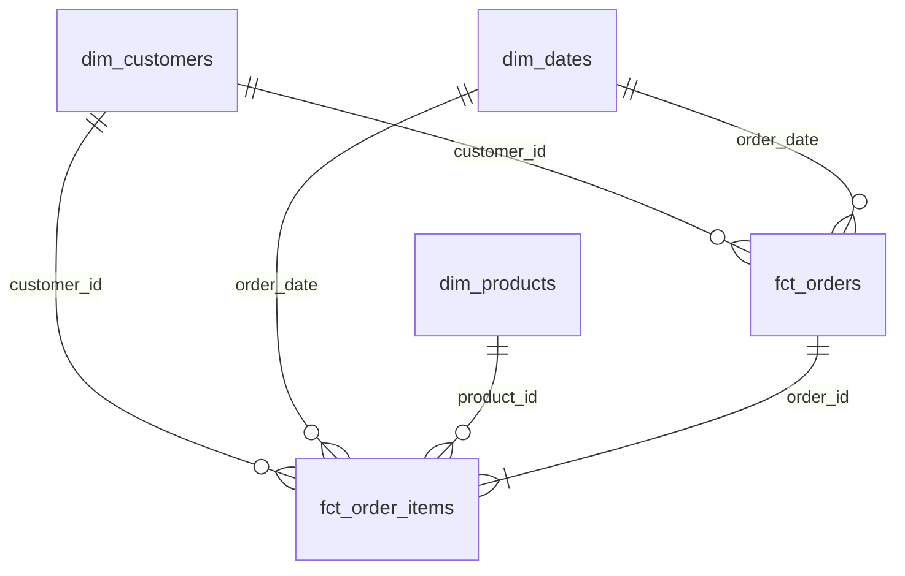
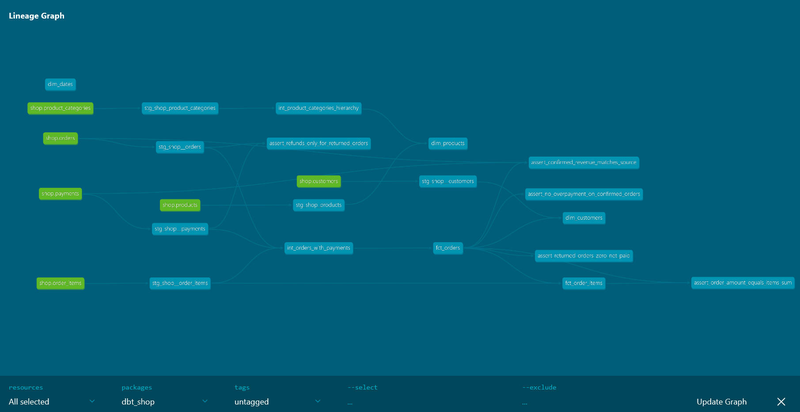

# Витрины интернет-магазина по схеме «звезда» (Greenplum + dbt)

Аналитический слой хранилища данных в **Greenplum** (`dwh`), реализованный с помощью **dbt** со слоями `staging`, `intermediate` и `marts`.

---

## Модель данных

### ER-диаграмма звезды

### Описание витрин (`analytics_marts`)

* **`fct_orders`** *Зернистость:* одна строка один заказ (без тестовых). *Бизнес-вопрос:* какова общая динамика подтверждённой выручки, числа заказов, среднего чека и возвратов?
* **`fct_order_items`** *Зернистость:* одна строка один товар в заказе. *Бизнес-вопрос:* какова выручка по категориям товаров и месяцам, и какие бренды чаще возвращают?
* **`dim_customers`** *Зернистость:* одна строка один зарегистрированный клиент (включая не купивших). *Бизнес-вопрос:* какова доля покупателей по каналам привлечения (`acquisition_channel`) и средний чек / LTV по городам (`city`)?
* **`dim_products`** *Зернистость:* одна строка один товар с развёрнутой трёхуровневой иерархией категорий. *Бизнес-вопрос:* как распределяются продажи и возвраты между корневыми (`Electronics`, `Home`) и дочерними категориями и брендами?
* **`dim_dates`** *Зернистость:* одна строка один календарный день. *Бизнес-вопрос:* как меняется покупательская активность по годам, кварталам, месяцам, дням недели и в выходные дни (`is_weekend`)?

---

### Хранение в Greenplum

| Витрина | Способ хранения в Greenplum | Обоснование выбора |
| :--- | :--- | :--- |
| `fct_orders` | `DISTRIBUTED BY (order_id)` | Ключ `order_id` имеет высокую кардинальность и равномерно распределяет строки по сегментам Greenplum. Совпадает с распределением сырых таблиц `raw.orders`, `raw.order_items` и `raw.payments`, обеспечивая локальный JOIN без пересылки данных по сети. |
| `fct_order_items` | `DISTRIBUTED BY (order_id)` | Распределение по `order_id` совпадает с ключом распределения `fct_orders`. Если бы у `fct_order_items` и `fct_orders` были разные ключи распределения, при каждом JOIN между ними по `order_id` Greenplum пересылал бы строки между сегментами по сети (`Redistribute Motion`). |
| `dim_customers` | `DISTRIBUTED REPLICATED` | Небольшое измерение (40 строк): хранение полной копии таблицы на каждом сегменте позволяет выполнять JOIN с фактами по `customer_id` локально без сетевого обмена. |
| `dim_products` | `DISTRIBUTED REPLICATED` | Маленький справочник товаров (13 строк): репликация на все сегменты исключает пересылку строк при соединении с `fct_order_items` по `product_id`. |
| `dim_dates` | `DISTRIBUTED REPLICATED` | Компактный календарь (133 дня): полная копия на каждом сегменте позволяет мгновенно соединять таблицы фактов с календарём по `order_date`. |

---

### Контроль качества данных и обнаруженные аномалии

В проекте настроены generic-тесты (`unique`, `not_null`, `relationships`, `accepted_values`, а также кастомный тест `non_negative`) и 4 singular-теста бизнес-логики:
1. `assert_order_amount_equals_items_sum` — сверка суммы заказа в `fct_orders` с суммой `line_amount` его позиций в `fct_order_items`.
2. `assert_confirmed_revenue_matches_source` — сверка подтверждённой выручки в витрине с расчётом напрямую по сырым таблицам `raw.orders` и `raw.payments`.
3. `assert_returned_orders_zero_net_paid` — проверка того, что по возвращённым заказам (`returned`) деньги вернулись полностью (`net_paid_amount = 0`).
4. `assert_no_overpayment_on_confirmed_orders` (`severity: warn`) — проверка отсутствия переплат по подтверждённым заказам. Тест выявил реальную аномалию в данных: по заказу **`order_id = 113`** при стоимости заказа `200.00` в источнике записано двойное успешное списание (`2 × 200.00 = 400.00`).

---

### Граф зависимостей (Lineage)

